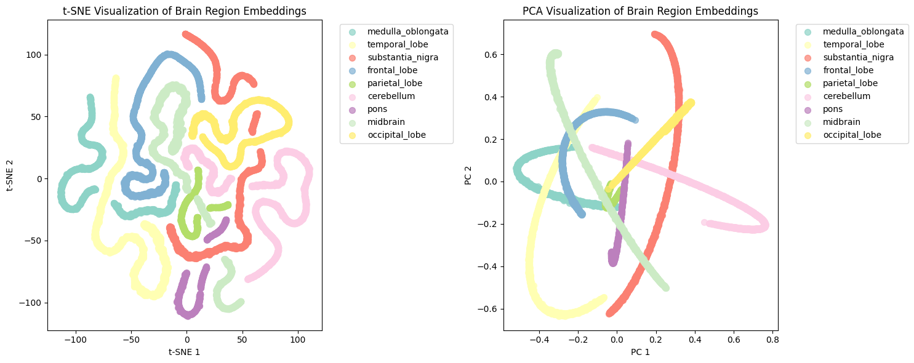
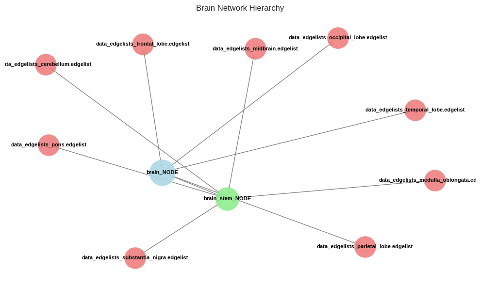
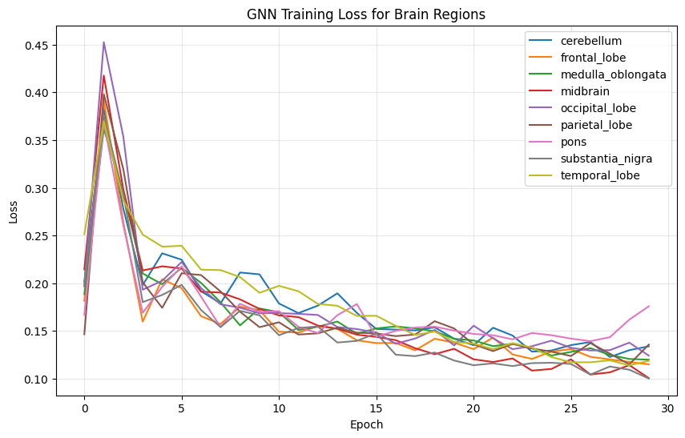

# Multicellular Function Prediction with Multi-layer Tissue Networks

**Final Year Project** — hierarchy-aware protein embeddings across tissue-specific
protein–protein interaction (PPI) networks, based on **OhmNet**
(Zitnik & Leskovec, *Bioinformatics* 2017), re-implemented from scratch and extended
with a **GNN (GraphSAGE) based variant**.



## Highlights
- Re-implementation of **OhmNet** (node2vec-style random walks + tissue-hierarchy regularization) in Python.
- Trained on **9 real human brain-region PPI networks** (frontal, temporal, parietal, occipital lobes, cerebellum, midbrain, pons, medulla oblongata, substantia nigra) from the SNAP `bio-tissue-networks` dataset.
- Produced **16,897 leaf protein embeddings** plus embeddings for the internal hierarchy nodes (`brain`, `brain stem`).
- Added a **GNN-OhmNet** model (GraphSAGE encoder per tissue) and an **optimized OhmNet** (parallel walks, GPU/Numba) for speed.
- Evaluation framework: OhmNet vs. Independent node2vec vs. Collapsed node2vec, with transfer-learning tests (AUROC / AUPRC).

## Tissue hierarchy used
Brain regions are tied together through a hierarchy (`brain → lobes`, `brain stem → midbrain / pons / medulla / substantia nigra`), which OhmNet uses to regularize embeddings so related tissues stay close.



## Results

### Real brain networks (GNN-OhmNet)
| Item | Value |
|---|---|
| Tissue networks | 9 brain regions (e.g. temporal lobe: 2,558 nodes / 38,269 edges) |
| Leaf embeddings | 16,897 |
| Embedding dimension | 128 |
| GNN training loss | ~0.20–0.45 (epoch 0) → ~0.10–0.13 (epoch 30), decreasing steadily for all regions |

Embeddings of each brain region form clearly separated, structured clusters in t-SNE / PCA (figure at the top).



### Method comparison (controlled benchmark with synthetic function labels)
Because tissue-specific function labels are not available for every region, the comparison below
uses a controlled setup with **synthetic networks and labels** to check that the pipeline and the
hierarchical regularization behave as expected. These numbers are *not* directly comparable to the
published results on real data.

| Approach | AUROC (avg) |
|---|---|
| **OhmNet (hierarchy-aware)** | **0.538** |
| Collapsed node2vec | 0.499 |
| Independent node2vec | 0.460 |

OhmNet scores highest in this setting, and the transfer-learning test shows the expected drop
when the target tissue is held out (avg. OhmNet AUROC drop ≈ 0.06).

### Reference: published results (Zitnik & Leskovec, 2017, real data)
| Approach | AUROC |
|---|---|
| OhmNet | 0.756 |
| Collapsed node2vec | 0.697 |
| Independent node2vec | 0.649 |

### Limitations / future work
- Evaluation on brain regions used synthetic labels, so GNN vs. OhmNet AUROC is ≈ 0.50 (chance level) there; a proper evaluation needs the real tissue-specific GO/function annotations from SNAP.
- Next steps: evaluate on real labels, tune hyperparameters (dimension, walk length, GNN layers), and compare against more baselines.

## Notebooks
| Notebook | Description |
|---|---|
| `FYP_Ohmnet (1).ipynb` | OhmNet implementation (utility, model, main) with baseline comparison |
| `Ohmnet_customized.ipynb` | Customized OhmNet: hierarchical regularization, transfer learning, OhmNet vs GNN |
| `Ohmnet_customized_V2.ipynb` | Optimized pipeline (parallel random walks, GPU, GraphSAGE) |
| `GNN.ipynb` | GNN-OhmNet on the real brain networks, with visualizations |

## Dataset
Tissue networks, labels and hierarchy from SNAP: <http://snap.stanford.edu/ohmnet/>
Download `bio-tissue-networks`, `bio-tissue-labels`, `bio-tissue-hierarchy` and extract next to the notebooks (not included in this repo because of size).

## Setup
```bash
pip install networkx numpy gensim scikit-learn matplotlib seaborn torch torch-geometric
```
The notebooks were run on Google Colab; change the Google Drive paths inside them if you run locally.

## Reference
Zitnik M., Leskovec J. *Predicting multicellular function through multi-layer tissue networks.* Bioinformatics 33(14), 2017.
